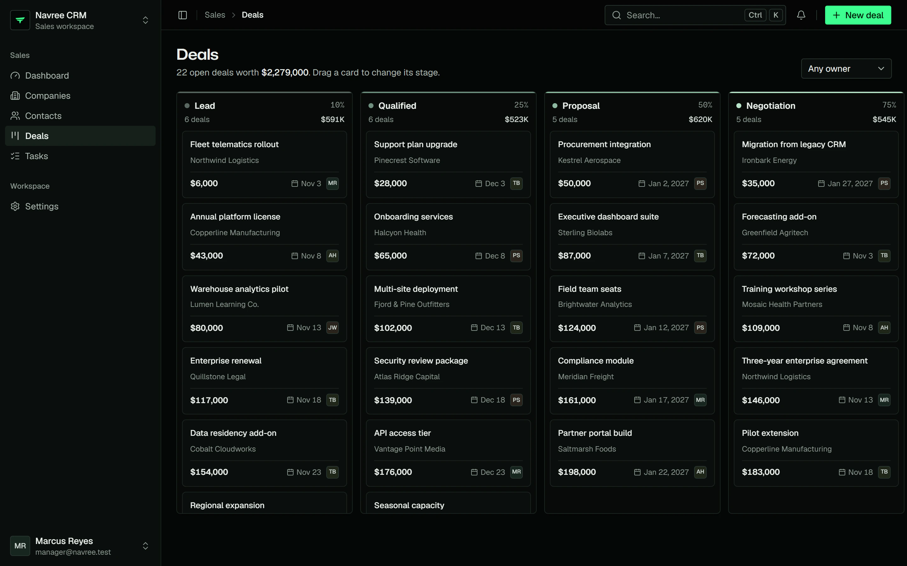
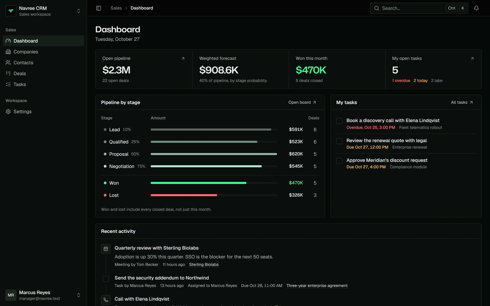
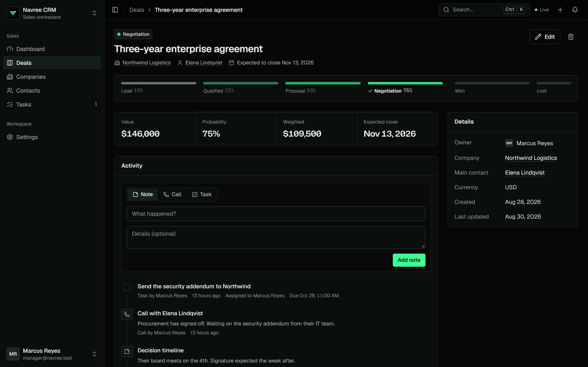

# Navree CRM

A complete CRM built on [Navree](https://github.com/NavreeHQ/navree): a Navree API with companies, contacts, a deals pipeline, tasks, an activity timeline, roles and an audit log, and two front ends on the same API, one in Next.js and one in Nuxt.

It is a real application, not a demo of one feature. It depends on the published `navree` crates and `@navree/*` packages, so it shows what a Navree app looks like when it lives in its own repository, and it is how we check that a release of the framework works for an app outside the framework's repository.

<a href="https://navree.com/showcase/crm/"></a>

<table>
  <tr>
    <td width="50%"></td>
    <td width="50%"></td>
  </tr>
</table>

## What is here

| Folder | What it is |
|---|---|
| `api/` | The Navree API (`crm-api`) and its crates: `crm-core` (models, migrations, abilities), `crm-users`, `crm-companies`, `crm-deals`, `crm-activities` and `crm-testkit` |
| `web/` | The Next.js front end, on `@navree/next` and `@navree/client` |
| `nuxt/` | The Nuxt front end, on `@navree/nuxt` and `@navree/client` |
| `docker/` | Dockerfiles for the API and the Next.js front end |
| `scripts/` | `use-framework.sh`, which points a build at a checkout of the framework |

## Run it

You need Rust 1.95 or newer, Node.js 24 and pnpm. Each long-running command goes in its own terminal.

```sh
cd api
echo "APP_KEY=base64:$(openssl rand -base64 32)" > .env   # once: tokens survive restarts
cargo run -p crm-api -- migrate:fresh --seed              # tables and demo data (SQLite)
cargo run -p crm-api -- serve                             # http://127.0.0.1:8080

cd ../web
pnpm install
pnpm dev                                                  # http://localhost:3000
```

Sign in as `rep1@navree.test` with the password `password123`. The login page has one-click demo accounts for the other roles. The Nuxt front end is the same: `cd nuxt && pnpm install && pnpm dev` (http://localhost:3102).

To try a front end without the API, `pnpm dev:mock` runs it against an in-browser mock.

## Test it

```sh
cargo test --workspace                                    # the API: unit, feature and OpenAPI tests
pnpm --dir web typecheck && pnpm --dir web test           # the Next.js unit tests
pnpm --dir nuxt typecheck && pnpm --dir nuxt test         # the Nuxt unit tests
```

The browser journeys (`pnpm --dir web e2e`, `pnpm --dir nuxt e2e`) start a real API and drive a real browser.

## Against the framework's main branch

The CRM asks for the framework the way an app of yours does (`navree = "1"`, `"@navree/next": "^1.0.0"`), and its lock files hold the exact versions. To build it against a checkout of the framework instead, for example to see whether a change there breaks an app:

```sh
git clone https://github.com/NavreeHQ/navree ../navree
scripts/use-framework.sh ../navree
cargo test --workspace
```

The script adds a `[patch.crates-io]` block that names every framework crate in the checkout, and points the front ends' `pnpm` overrides at the checkout's packages. `git status` shows what it touched, and `git checkout -- .` puts it back. The `Framework main` workflow does this every night.

## License

Free and open source under either of the [MIT license](LICENSE-MIT) or the [Apache License 2.0](LICENSE-APACHE), at your option.
